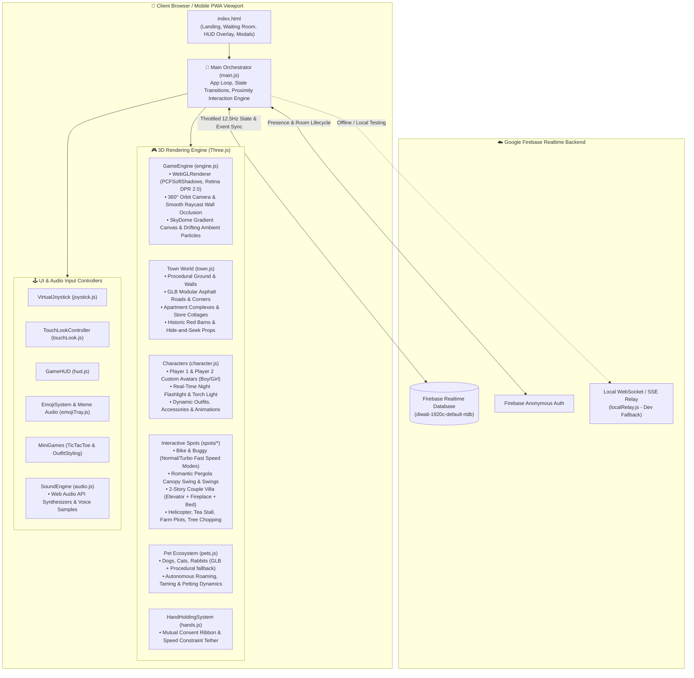
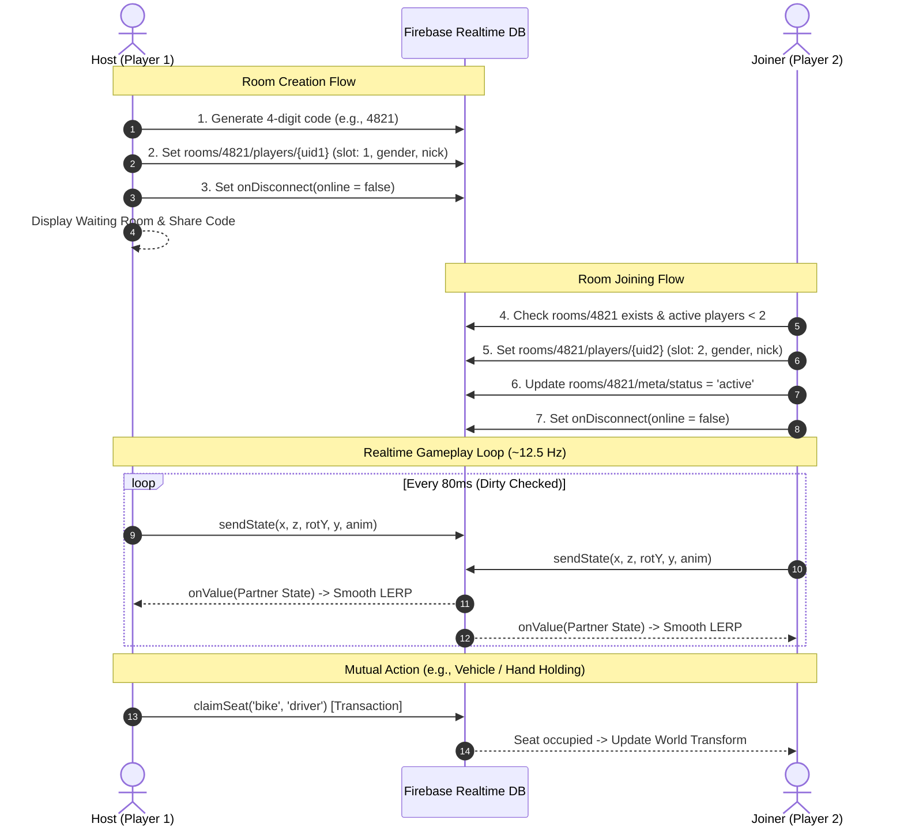

# 🏡 Our Little Town — Comprehensive Architecture & Technical Blueprint

> [!NOTE]
> **Our Little Town** ek modern, high-performance **2-Player 3D Real-Time Couple Cooperative Simulation Game** hai. Yeh Web browser aur Mobile PWA ke andar bina kisi native store installation ke direct link/room code ke zariye instant chalne ke liye engineer kiya gaya hai.
> **Tech Stack:** Vanilla JavaScript (ES Modules) + Three.js (WebGL 3D Rendering) + Google Draco WebAssembly Decoder + Firebase Realtime Database & Anonymous Auth + Vite.

---

## 🏗️ 1. High-Level System Architecture

Game ka overall data-flow aur runtime lifecycle teen core layers mein divide hai: **Presentation/View (Three.js & Canvas)**, **State & Network Orchestration (Firebase RTDB + SyncService)**, aur **UI / Input HUD (Touch, Joystick & Audio)**.



---

## 📁 2. File Directory & Codebase Breakdown

```
Our-Little-Town/
├── index.html                   # Master DOM, Viewport locks, Responsive Mobile Styles, HUD templates
├── package.json                 # Project scripts (dev, build, preview) & dependencies (three, firebase)
├── vite.config.js               # Dev server host binding, port 5173, SSE middleware setup
├── database.rules.json          # Security validation rules for Realtime Database rooms
├── firebase.json                # Firebase hosting & header cache configuration
├── .env / .env.example          # Firebase project credentials (API Key, Database URL, Project ID)
│
├── public/                      # Static assets served as-is
│   ├── draco/                   # ⚡ Local WebAssembly Draco Decoders (draco_decoder.wasm, js, wrapper)
│   ├── GLBs/                    # 3D GLTF/GLB Binary Assets
│   │   ├── ANIMALS (1..3).glb   # 3D Animated models for Dog, Cat, and Rabbit
│   │   └── assets/              # Modular 3D environment pieces:
│   │       ├── road-straight-accessible-01.glb   # Real black asphalt road tile with kerbs & markings
│   │       ├── road-corner-accessible-01.glb     # 90-degree corner road piece
│   │       ├── agora-flagstone-tile.glb          # Cobblestone courtyard & pedestrian pathway tiles
│   │       ├── airfield-grass-tile.glb           # Detailed grass tiles for lawn & park floor
│   │       ├── apartment-block-01.glb            # Multi-story downtown apartment buildings
│   │       ├── bld-general-store-01.glb          # Village store & hideout cottages
│   │       ├── big-red-barn.glb                  # Grand farmstead & meadow barns for hide-and-seek
│   │       ├── bench-01.glb                      # Park sitting benches
│   │       └── creek-stepping-stones.glb         # Crossing stepping stones
│   └── audio/                   # Voice lines & situational meme audio clips
│
└── src/                         # Source Code
    ├── main.js                  # 🧠 Master Game Orchestrator & RequestAnimationFrame Tick Loop
    ├── audio.js                 # 🎵 Web Audio API Sound Synthesizer Engine
    │
    ├── game/                    # 🎮 Three.js 3D Game World & Logic
    │   ├── engine.js            # Scene, Camera Orbit, PCFSoft Shadows, Renderer, Sky & Day/Night
    │   ├── loader.js            # DRACOLoader + GLTFLoader singleton with local wasm decoding
    │   ├── town.js              # Town Builder: Ground, GLB roads, stores, barns, fountain, colliders
    │   ├── character.js         # Procedural Boy/Girl character model, rigging, torch, animations
    │   ├── hands.js             # Mutual couple hand-holding tether, ribbon & proximity
    │   ├── pets.js              # Autonomous AI Pet System (Dogs, Cats, Rabbits, Taming & Petting)
    │   └── spots/               # 📍 Interactive Locations & Vehicles
    │       ├── bike.js          # Retro Vespa Scooter (Normal / Turbo Fast mode, physics tilt)
    │       ├── buggy.js         # Retro Beach Buggy / Offroad Jeep (2-Seater, Fast/Normal toggle)
    │       ├── helicopter.js    # Flyable Helicopter (Dual seats, pitch/roll, altitude control)
    │       ├── house.js         # 2-Story Couple Villa (Glass elevator, fireplace, master bed, lights)
    │       ├── canopySwing.js   # Romantic Garden Pergola Canopy Double Swing
    │       ├── swing.js         # Classic Playground Double Swings
    │       ├── chair.js         # Village benches system with dual couple seat allocations
    │       ├── playground.js    # Slide with physics drop, Seesaw
    │       ├── farming.js       # 4-stage farming cycle (Till → Seed → Water → Harvest)
    │       ├── treeChopping.js  # Choppable timber trees with health, regrowth & wood inventory
    │       └── teaStall.js      # Cozy roadside Tea Stall with tea cup drink animations
    │
    ├── firebase/                # ☁️ Realtime Networking & Persistence
    │   ├── config.js            # Firebase App & Database initializer with mock fallback
    │   ├── roomService.js       # 4-digit room code creation, strict validation, presence management
    │   ├── syncService.js       # 12.5Hz throttled lerp sync for coordinates, anims, spots & reactions
    │   ├── localRelay.js        # Local LAN/multi-tab SSE relay server for dev environment
    │   └── mockFirebase.js      # In-memory BroadcastChannel mock for zero-internet testing
    │
    └── ui/                      # 🖥️ DOM HUD & User Controls
        ├── hud.js               # In-Game Action HUD, speed toggle button, inventory pills, flight row
        ├── joystick.js          # Virtual touch joystick with camera-relative vector mapping
        ├── touchLook.js         # 360° screen drag orbit & pinch-to-zoom camera controller
        ├── emojiTray.js         # Reactive floating emoji drawer, stickers & meme player
        └── miniGames/           # 🎲 Synchronized In-Game Mini-Games
            ├── ticTacToe.js     # Real-time competitive 3x3 Tic-Tac-Toe
            └── outfitGame.js    # "Style Your Partner" interactive closet dressing game
```

---

## ⚡ 3. Core Modules & Engine Internals

### 3.1 3D Engine & Graphics Pipeline (`src/game/engine.js`)
* **Renderer**: `THREE.WebGLRenderer` configured with `antialias: true`, `precision: 'highp'`, `powerPreference: 'high-performance'`, and `THREE.SRGBColorSpace`.
* **Retina High-Definition**: Automatically locks to `Math.min(window.devicePixelRatio, 2.0)`, giving high sharpness on iPhone Retina and Android AMOLED displays.
* **Lighting & Shadows**: 
  - Dynamic `DirectionalLight` (Sun/Moon) casting high-res (1024×1024) `PCFSoftShadowMap`.
  - Ambient + Hemisphere dual gradient lighting for soft pastel illumination.
* **Smart Third-Person Orbit Camera**:
  - Chase camera with 360° horizontal Yaw and vertical Pitch clamps (preventing ground inversion).
  - Built-in **Raycast Wall Occlusion**: Camera checks obstacles between target character and camera eye, automatically zooming in smoothly (0.28m clearance) so the camera never clips through villa walls or roofs.
* **Day/Night Cycle**:
  - Live procedural gradient transition on a negative-scaled spherical SkyDome.
  - Switches ambient illumination, activates cool moonlight, and automatically turns on the player's handheld flashlight.

### 3.2 Procedural Town & Modular 3D World (`src/game/town.js`)
* **World Bounds**: 150×150 meter world enclosed by styled perimeter boundary walls with AABB collision boxes.
* **Modular GLB Road Infrastructure**:
  - Real black asphalt roads with yellow tactile pavements and white road line markings assembled seamlessly using `road-straight-accessible-01.glb` and `road-corner-accessible-01.glb`.
  - Cobblestone agora pedestrian tiles leading from the couple villa to the park and farm.
* **Hide & Seek Cityscape**:
  - Multi-story apartment buildings (`apartment-block-01.glb`) with doorways left open.
  - General stores, bakeries, and cafes (`bld-general-store-01.glb`).
  - Grand Historic Red Barns (`big-red-barn.glb`) with 3.2m entrance doorways.
  - Tactical cover props: Central plaza marble fountain, romantic gazebo, hay bale stacks, wooden cargo crates, barrels, and flower hedges.
* **Collision Detection System**:
  - Optimized composite collision list (`checkCollision(x, z, radius)`) checking both bounding circles (fountain, trees, tables) and AABB bounding boxes (walls, buildings, hedges).

### 3.3 Dynamic Character System (`src/game/character.js`)
* **Model Rigging**: Hierarchical Three.js procedural character featuring head, torso, shoulder pivots, arm pivots, and hip leg pivots.
* **Gender Select**:
  - **Boy**: Sky-blue palette, short combed hair mesh.
  - **Girl**: Soft pink palette, side pigtails, and angled eyelashes.
* **Action Animations**: Hand-crafted rotational keyframes for `idle`, `walk`, `jump`, `ride`, `passenger`, `swing`, `sit`, `sleep`, `hug`, `chop`, `farm`, `slide`, and `cheer`.
* **Dynamic Torch**: Handheld spotlight that activates during Night mode with a targeted forward cone beam.

---

## 📡 4. Realtime Multiplayer Networking Architecture



### 4.1 Room & Presence Management (`roomService.js`)
* **4-Digit Code System**: Strict numeric 4-digit codes (`1000` to `9999`) for ease of sharing on mobile screens.
* **Resilient Join Logic**: Checks whether registered slots are currently active (`online !== false`). Abandoned/disconnected slots are automatically recycled so rooms never get permanently locked.
* **Automatic Disconnect Handlers**: Firebase `onDisconnect()` hooks instantly flip `online: false`, vacate occupied vehicle seats, and release held hands when a player closes their mobile browser or switches tabs.

### 4.2 Interpolated Movement & Throttled Sync (`syncService.js`)
* **Throttled Broadcast (12.5 Hz)**: Player positions are transmitted every 80ms, but only if position or rotation has moved past a deadzone threshold (`Δ > 0.01m`).
* **Hermite / Linear Interpolation (LERP)**: The receiving client buffers the partner's last received target vector and smoothly interpolates the position and rotation every frame, eliminating network jitter.

---

## 🕹️ 5. Vehicles, Activities & Systems Matrix

| Spot / Feature | File Location | Seats / Roles | Mechanics & Controls |
| :--- | :--- | :--- | :--- |
| **Retro Vespa Scooter** | `src/game/spots/bike.js` | Driver + Passenger | Steering physics, tilt banking, **Speed Mode Toggle** (`Normal`: 9.5 m/s, `Turbo Fast`: 16.5 m/s) via UI Button / `KeyF` / `Shift`. |
| **Beach Buggy Jeep** | `src/game/spots/buggy.js` | Driver + Passenger | Chunky offroad body, steering wheel, **Fast / Normal** speed modes. |
| **Aerial Helicopter** | `src/game/spots/helicopter.js` | Pilot + Passenger | Real flight mechanics, Altitude Ascent/Descent (`Space`/`C` or HUD buttons), Pitch & Roll tilt. |
| **Couple Dream Villa** | `src/game/spots/house.js` | Bed Left + Bed Right | 2-Story modern villa, working glass elevator cabin, toggleable living room lighting, sleeping Zzz particle emitter. |
| **Pergola Canopy Swing** | `src/game/spots/canopySwing.js` | Dual Seats | Romantic curved timber pergola with synced pendulum swing animation. |
| **Interactive Pets** | `src/game/pets.js` | Dogs, Cats, Rabbits | Autonomous wandering AI, pathfinding, player taming (`Tame!`), following behavior, and petting hearts. |
| **Hand Holding** | `src/game/hands.js` | Couple (Mutual) | Requires both players to hold button; pink energy ribbon links hands; speed locks into matched pace. |
| **Farming System** | `src/game/spots/farming.js` | Community Plots | 4-Stage lifecycle: Till Soil → Plant Seed → Water Crop → Harvest. Inventory syncs to player HUD. |
| **Timber Harvesting** | `src/game/spots/treeChopping.js` | Forest Trees | Ax chopping animation, tree health bar (3 hits), falling trunk animation, timed regrowth. |
| **Tic-Tac-Toe** | `src/ui/miniGames/ticTacToe.js` | 2 Players | Turn-based 3×3 board synced over Firebase with win detection & animations. |
| **Style Your Partner** | `src/ui/miniGames/outfitGame.js` | 2 Players | Select hats, top colors, bottom colors, and accessories for your partner with real-time acceptance prompts. |

---

## 🎨 6. UI, Mobile Optimization & Touch Input

* **Zero-Zoom Mobile Viewport**: Locked with `viewport-fit=cover`, `maximum-scale=1.0`, and CSS `touch-action: none` to eliminate unwanted Safari/Chrome rubber-banding.
* **Virtual Joystick (`src/ui/joystick.js`)**: Dynamic touch thumbstick that calculates movement relative to current camera facing angle.
* **Touch Look Controller (`src/ui/touchLook.js`)**: Drag on any empty screen area to orbit camera 360° around your character.
* **Contextual HUD (`src/ui/hud.js`)**: Single floating action button that dynamically adapts label, icon, and callback based on proximity:
  - Near Bench ➔ `"Sit on Bench 🪑"`
  - Near Scooter ➔ `"Drive Scooter 🛵"`
  - Near Farm Plot ➔ `"Plant Seed 🌾"`
  - Driving Vehicle ➔ `"Speed: Fast / Normal ⚡"` button appears.

---

## 🔒 7. Security, Deployment & Production Build

* **Production Bundler**: Vite transforms and minifies ES modules into optimal chunks in `dist/`.
* **Draco Decoding Performance**: WebAssembly (`.wasm`) decoder bundled locally in `public/draco/`, ensuring instant geometry decompression without external CDN latency or mobile firewall blocks.
* **Firebase Rules (`database.rules.json`)**:
  - Enforces anonymous authentication for read/write access.
  - Room validation ensures maximum of 2 player slots per room.
* **Deployment Targets**:
  - **Firebase Hosting**: Native target configured via `firebase.json`.
  - **Vercel**: Pre-configured rewrites via `vercel.json`.
  - **Progressive Web App (PWA)**: Cache-first Service Worker (`sw.js`) and manifest (`manifest.json`) enabling single-tap "Add to Home Screen" full-screen gameplay.
