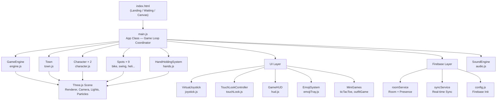
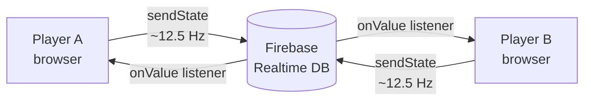
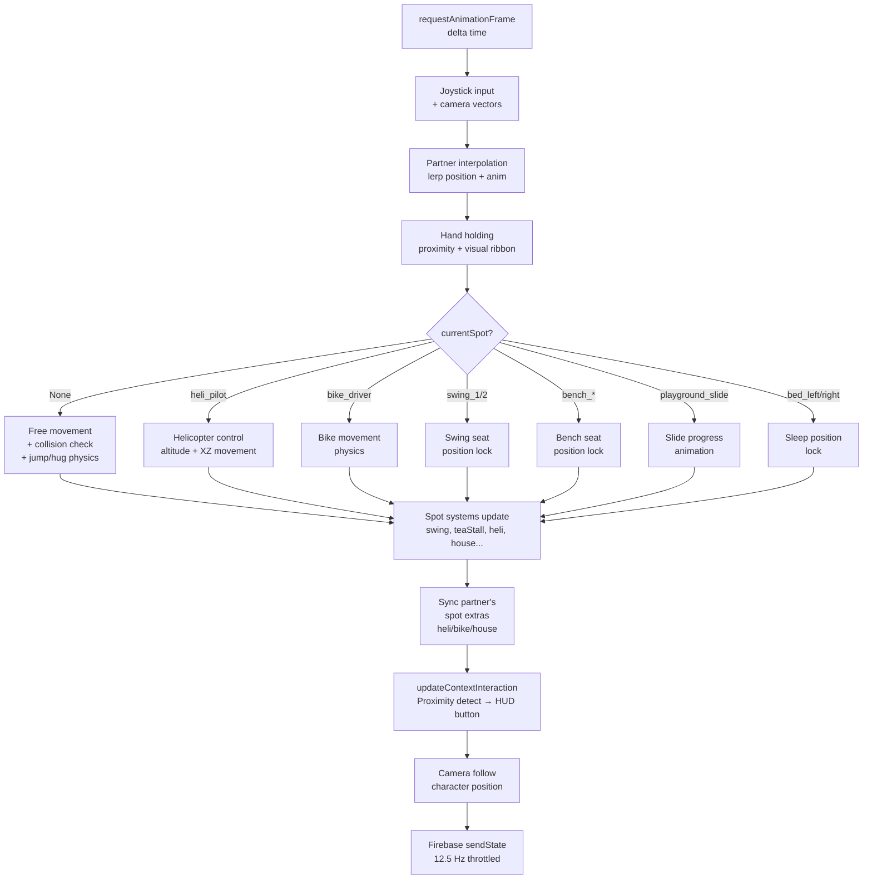

# 🏡 Our Little Town — Game Architecture

> [!NOTE]
> Yeh ek **browser-based 3D couple multiplayer game** hai — Two players ek shared romantic town mein explore karte hain, activities karte hain aur ek doosre ke saath interact karte hain. Built with **Three.js + Firebase Realtime Database + Vite PWA**.

---

## 📁 Project Structure Overview

```
New folder (2)/
├── index.html                   # Entry HTML, all screens (landing, waiting, game HUD)
├── vite.config.js               # Vite build config
├── package.json                 # Dependencies (three, firebase, playwright)
├── firebase.json                # Firebase Hosting config
├── database.rules.json          # Firebase RTDB security rules
├── vercel.json                  # Vercel deployment config (alternative to Firebase)
├── sw.js                        # Service Worker (PWA caching)
├── manifest.json                # PWA manifest
│
├── src/
│   ├── main.js                  # 🧠 App entrypoint & Game Loop Coordinator
│   ├── audio.js                 # 🎵 Web Audio Synthesizer (no audio files)
│   │
│   ├── game/                    # 🎮 Core 3D Game Logic
│   │   ├── engine.js            # Three.js rendering engine
│   │   ├── town.js              # Procedural town world builder
│   │   ├── character.js         # Player character mesh + animations
│   │   ├── hands.js             # Hand-holding mechanic system
│   │   └── spots/               # 🗺️ Interactive Locations
│   │       ├── bike.js          # Retro scooter (2 seats: driver + passenger)
│   │       ├── chair.js         # Park benches (8 locations, couples sit together)
│   │       ├── farming.js       # Farm plots (till → plant → water → harvest)
│   │       ├── helicopter.js    # Flyable helicopter (pilot + passenger)
│   │       ├── house.js         # 2-story couple villa (elevator + bedroom)
│   │       ├── playground.js    # Playground (slide + seesaw)
│   │       ├── swing.js         # Romantic swings (2 seats)
│   │       ├── teaStall.js      # Tea stall (hold chai cup)
│   │       └── treeChopping.js  # Choppable trees (wood inventory)
│   │
│   ├── firebase/                # ☁️ Backend / Networking
│   │   ├── config.js            # Firebase app init + DB helper wrappers
│   │   ├── roomService.js       # Room creation, joining, presence management
│   │   ├── syncService.js       # Real-time state sync (position, anim, spots, reactions)
│   │   ├── localRelay.js        # Local multiplayer relay (same-device testing)
│   │   └── mockFirebase.js      # Mock Firebase for offline/dev mode
│   │
│   └── ui/                      # 🖥️ UI Layer
│       ├── hud.js               # In-game HUD (buttons, room code, inventory, overlays)
│       ├── joystick.js          # Virtual joystick for mobile
│       ├── touchLook.js         # Touch drag for 360° camera orbit
│       ├── emojiTray.js         # Emoji reaction tray + floating emoji spawner
│       └── miniGames/
│           ├── ticTacToe.js     # Shared Tic Tac Toe mini-game
│           └── outfitGame.js    # Couple outfit matching mini-game
│
└── tests/
    └── gameplay.spec.js         # Playwright end-to-end tests
```

---

## 🏛️ Architecture Layers



---

## 🔑 Core Modules — Detail

### `src/main.js` — App Class (Brain)
Pura game ka **orchestrator**. Yahan sab kuch connect hota hai.

| Method | Kya karta hai |
|--------|--------------|
| `initPWA()` | Service worker register karta hai, PWA install banner handle karta hai, Wake Lock leta hai |
| `initDOM()` | Landing, waiting screens ke DOM refs leta hai, URL se room code parse karta hai |
| `init3D()` | Engine, Town, aur sare 9 Spots initialize karta hai |
| `initUI()` | Joystick, camera controls, HUD, emoji system, mini-games setup karta hai |
| `initFlow()` | "Create Room" / "Join Room" button handlers — Firebase room banata/join karta hai |
| `onRoomReady()` | Character spawn karta hai, waiting screen show/hide karta hai, game loop shuru karta hai |
| `onTick(delta)` | **Main game loop** — movement, animations, spot logic, camera update, Firebase sync |
| `updateContextInteraction()` | Proximity check karta hai — nearby spots detect karke HUD button update karta hai |
| `handleInteraction()` | Player ke interact button press par action perform karta hai |
| `exitSpot()` | Current spot se bahar nikalta hai, Firebase mein seat release karta hai |

---

### `src/game/engine.js` — GameEngine
Three.js ka wrapper. **Renderer + Camera + Lighting + Particles**.

| Feature | Details |
|---------|---------|
| Renderer | WebGLRenderer, PCFSoft shadows, SRGB color space |
| Camera | PerspectiveCamera (56° FOV), Third-person 360° orbit |
| Sky | Pastel gradient SphereGeometry sky dome (canvas texture) |
| Lights | Ambient + Hemisphere + Directional sun (with shadow maps) |
| Particles | 130 floating pastel petals (canvas-based sprite texture) |
| FPS Tracking | Auto quality switch to `low` if avg FPS < 28 |
| Quality Modes | `high` (shadows + particles) / `low` (shadows/particles off) |

---

### `src/game/town.js` — Town
**150×150 unit procedural world** — no external textures, sab procedurally banaya gaya.

Kya banata hai:
- Ground plane + boundary walls (pastel purple)
- Roads aur paths
- Central fountain plaza
- River aur bridge
- Multiple buildings (pastel colored roofs)
- Romantic gazebo
- Expanded park area
- Trees aur street lamps
- **Collision system** (`checkCollision(x, z, radius)`) — box-based AABB

---

### `src/game/character.js` — Character
**Low-poly procedural 3D character** — no GLTF files, sab Three.js geometry.

| Feature | Details |
|---------|---------|
| Slots | Slot 1 = Pink outfit, Slot 2 = Blue outfit |
| Body Parts | Head, torso, arms, legs, feet — MeshLambertMaterial |
| Accessories | Hat (mushroom/flower/crown), cup (when at tea stall) |
| Animations | `idle`, `walk`, `jump`, `swing`, `ride`, `passenger`, `sit`, `sleep`, `hug`, `chop`, `farm`, `slide`, `cheer` |
| Nickname Label | Billboard canvas texture above character head |
| Outfit System | `applyOutfit({hat, topColor, bottomColor, accessory})` |

---

### `src/game/hands.js` — HandHoldingSystem
Couple ka **hand-holding mechanic** — mutual consent required (dono players button hold karein).

- Proximity check (3.0 units range)
- Visual ribbon (pink glowing `THREE.Line`)
- Movement blending — hands hold karne par dono players close rehte hain, speed kam hoti hai
- Firebase sync — `syncService.isBothHolding()` se state check hoti hai

---

## 🗺️ Interactive Spots

| File | Spot | Seats / Actions | Special Features |
|------|------|----------------|-----------------|
| `bike.js` | 🛵 Retro Scooter | Driver + Passenger | Drivable, physics-based turning, Firebase sync |
| `swing.js` | 🎠 Romantic Swings | Seat 1 + Seat 2 | Animated swinging motion |
| `helicopter.js` | 🚁 Helicopter | Pilot + Passenger | Flyable (altitude up/down), pitch/roll animation |
| `house.js` | 🏠 Couple Villa | Bed Left + Bed Right | 2-story, working elevator, light switch toggle, zzz particles |
| `playground.js` | 🛝 Playground | Slide + Seesaw | Animated slide progress, seesaw animation |
| `chair.js` | 🪑 Park Benches | Left + Right (couple) | 8 locations across town |
| `teaStall.js` | 🍵 Tea Stall | 1 player interaction | Character holds chai cup |
| `farming.js` | 🌾 Farm Plots | Multiple plots | 4-stage cycle: `empty → tilled → seeded → growing → ready` |
| `treeChopping.js` | 🪓 Trees | Any nearby tree | 3 health per tree, wood inventory, trees regrow |

---

## ☁️ Firebase Layer



### `roomService.js` — Room Management
- **Room code**: 5-char alphanumeric (safe chars, no ambiguous like 0/O/1/I)
- Anonymous Firebase Auth (`signInAnonymously`)
- Slots: Player 1 = creator, Player 2 = joiner
- `onDisconnect` hooks — Firebase automatically marks player offline
- Reconnect on tab visibility / network restore
- Default outfits stored per player slot

### `syncService.js` — Real-time Sync
Kya sync hota hai:

| Data | Frequency | Path |
|------|-----------|------|
| Position (x, z, rotY, y) | ~12.5 Hz (80ms throttle, dirty check) | `rooms/{id}/players/{uid}/state` |
| Animation name | ~12.5 Hz | same as above |
| Seat occupancy | On interaction | `rooms/{id}/spots/{spotId}/occupants` |
| Spot extra (heli pos, elevator Y, light state) | On change | `rooms/{id}/spots/{spotId}/extra` |
| Emoji reactions | On send | `rooms/{id}/reactions` (push) |
| Tic-Tac-Toe moves | On move | `rooms/{id}/games/tictactoe` |
| Outfit picks | On change | `rooms/{id}/games/outfit` |
| Hand holding state | On toggle | `rooms/{id}/hands` |

**Partner Interpolation**: Jerk-free movement — partner ki position smoothly lerp hoti hai har frame mein.

---

## 🖥️ UI Layer

| File | Component | Kya karta hai |
|------|-----------|--------------|
| `hud.js` | GameHUD | Room code, interaction button, flight controls, hold hands, hug, inventory, presence indicator, look invite overlay |
| `joystick.js` | VirtualJoystick | Mobile virtual thumbstick, camera-relative movement vectors return karta hai |
| `touchLook.js` | TouchLookController | Touch drag → `engine.rotateCamera()`, double-tap → camera reset |
| `emojiTray.js` | EmojiSystem | Emoji picker tray + floating emoji spawn (absolute positioned DOM elements) |
| `miniGames/ticTacToe.js` | TicTacToeGame | Full Tic-Tac-Toe shared between both players via Firebase |
| `miniGames/outfitGame.js` | OutfitGame | Couple outfit designer — partner ke picks ko accept/decline kar sakte ho |

---

## 🎵 Audio (`src/audio.js`)
**100% self-contained Web Audio API synthesizer** — koi external audio files nahi.

| Method | Sound |
|--------|-------|
| `playPop()` | Button press / generic interaction |
| `playCheer()` | Partner joins / slide complete |
| `playHugChime()` | Hug animation |
| `playHelicopter()` | Helicopter engine loop |
| `playBell()` | Elevator arrival |
| `playElevator(up)` | Elevator move start |
| `playSip()` | Chai sip |
| `playSleep()` | Sleep start |
| `playAngry()` | Angry emoji reaction |
| `playPlantSeed()` | Farming — plant |
| `playWaterCrop()` | Farming — water |
| `playHarvest()` | Farming — harvest |

---

## 🔄 Game Loop (`onTick`)



---

## 🌐 Deployment

| Platform | Config File | Notes |
|----------|-------------|-------|
| Firebase Hosting | `firebase.json` | Primary deploy target |
| Vercel | `vercel.json` | Alternative deploy |
| PWA | `sw.js` + `manifest.json` | Offline cache, installable |

---

## 🧪 Testing

**Playwright** end-to-end tests (`tests/gameplay.spec.js`):
- PWA manifest & service worker check
- Portrait orientation overlay
- Player A creates room → waiting screen
- Player B joins → both connected
- Hand holding mechanic
- Emoji send/receive
- Tic-Tac-Toe shared game
- Outfit reveal flow
- Partner offline detection

---

## ⚡ Key Design Decisions

> [!IMPORTANT]
> **No 3D model files** — saare characters, buildings, spots sab kuch `THREE.BoxGeometry` / `THREE.CylinderGeometry` etc. se procedurally banaye gaye hain. Load time near-zero.

> [!TIP]
> **Dirty-check sync** — position sirf tab Firebase ko bheja jata hai jab actually change ho (0.01 unit threshold), bandwidth save hota hai.

> [!NOTE]
> **Mutual consent** mechanic — hand holding, helicopter/bike seats, bench seating sab Firebase transactions se claim kiye jaate hain taaki dono players conflict na ho.

> [!WARNING]
> **localRelay.js / mockFirebase.js** — Development/testing ke liye hai. Production mein real Firebase config (`.env`) chahiye.
